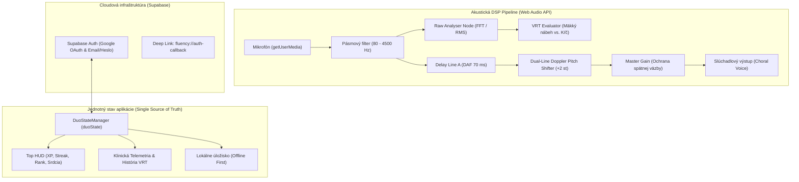

# 🎙️ Glide – Evidence-Based Rečový Biofeedback & Neuroakustický Asistent

Evidence-based neuroakustický trenažér plynulej reči a osobný asistent navrhnutý pre dospelých a dospievajúcich s **balbuties (zajakavosťou / koktavosťou)**. Žiadny vizuálny chaos, žiadne detské gýče ani prázdne ezoterické teórie. Všetko funguje na báze exaktnej akustickej biometrie v reálnom čase priamo v zariadení (**Edge DSP** cez Web Audio API).

---

## 📲 Stiahnutie mobilnej aplikácie (Android)

| Formát | Inštalačný odkaz | Špecifikácia |
| :--- | :--- | :--- |
| **Android APK** | [**📥 Stiahnuť glide-native.apk**](https://github.com/baranaikooo/glide/releases/latest/download/glide-native.apk) | Najnovší inštalačný balíček pre Android (~4.99 MB) |

### 🚀 Návod na inštaláciu APK do smartfónu:
1. Klikni na odkaz vyššie a stiahni súbor `glide-native.apk` priamo do telefónu.
2. Otvor stiahnutý súbor v notifikačnej lište alebo v správcovi súborov.
3. Ak ťa Android vyzve, povoľ *„Inštalovať neznáme aplikácie“* pre daný prehliadač / správcu.
4. Klikni na **Inštalovať** a po dokončení spusti aplikáciu priamo z plochy.
5. Pri prvom spustení potvrď povolenie pre **Mikrofón** (potrebný pre analýzu VRT a DAF/FAF odposluch) a **Kameru** (používanú v 5. svete pri nácviku očného kontaktu).

---

## 🌟 5 Vedeckých pilierov aplikácie

### 1. 🎧 Osobný Rečový Asistent – Skutočný Doppler FAF + DAF
* **Dual-Line Doppler Pitch Shifter (FAF – Frequency Altered Feedback):** Na rozdiel od bežných aplikácií, ktoré používajú iba lacný EQ filter na výšky, Glide implementuje skutočný real-time pitch shifter s **dvoma paralelnými modulovanými delay linkami s fázovým posunom 180°** (Crossfaded Sawtooth LFO modulujúce oneskorenie v 15 ms okne).
* **Posun o +2 poltóny (faktor ~1.12x):** Druhá vetva hlasu v reálnom čase zvyšuje základnú frekvenciu ($F_0$), čo v kombinácii s DAF (70 ms) generuje autentický **zborový efekt (Choral Speech Effect)** bez kovového hrebeňového skreslenia (comb filtering).
* **Neurologický princíp:** Obchádza časovú dysfunkciu bazálnych ganglií a aktivuje temporo-parietálny feedbackový okruh (Kalinowski et al., Alm 2004).
* **Ochrana pred spätnou väzbou:** Slúchadlový odposluch je pri štarte predvolene stlmený (`0.0 gain`), aby pri zapnutí bez slúchadiel nedochádzalo k pískaniu z reproduktora do mikrofónu. Indikátor v hornej lište umožňuje okamžité zapnutie/vypnutie jedným kliknutím.

### 2. ⚡ Objektívny DSP Biofeedback & Vocal Rise Time (VRT)
* **Meranie prechodového javu fonácie (ms):**
  * 🔴 **Tvrdý glotálny ráz (`VRT < 45 ms`):** Kŕčové zovretie hlasiviek (laryngeálna hyperaddukcia) typické pre zajakavosť.
  * 🟢 **Mäkký nábeh reči / Gentle Onset (`VRT 45 – 160 ms`):** Hladká, aerodynamicky riadená aproximácia hlasiviek bez nárazového tlaku.
* **Automatická 1-sekundová kalibrácia šumu:** Pri prvom spustení paceru algoritmus zmeria skutočnú hladinu akustického šumu v miestnosti (`noiseDb`) a dynamicky adaptuje prahové hodnoty detektora, čím eliminuje falošné štarty a latencie.
* **Fonetická adaptácia:** Algoritmus rozlišuje otvorené samohlásky (napr. *otec*, *áno*) a plozívy, čím eliminuje falošné hlásenia blokov.

### 3. 📋 Vedecký Diagnostický Dotazník Balbutizmu (Škála 1 – 5)
* **Klinická metodika:** Vstupné vyšetrenie postavené na štandardoch logopedických a psychologických škál **SSI-4** (*Stuttering Severity Instrument*) a **OASES** (*Overall Assessment of the Speaker's Experience of Stuttering*).
* **3 Vyšetrovacie domény na Likertovej škále (1 = Vôbec až 5 = Silne):**
  1. *Motorické prejavy:* Glotálny kŕč na samohláskach, plozívny artikulačný pretlak (P, B, T, K), prolungácie (ťahanie znelých zvukov) a klonické zrýchlené opakovania.
  2. *Sociálny stres:* Intenzita úzkosti a obáv z hodnotenia pri telefonovaní, predstavovaní sa menom či v práci.
  3. *Prioritný cieľ:* Výber najkritickejšej komunikačnej situácie.
* **Adaptívne zaradenie:** Systém vypočíta individuálny neuro-profil reči a automaticky prescrolluje používateľa do odporúčaného štartovacieho sveta (Svet 1 až 5).

### 4. 🫁 Valsalvov reflex & SOS Mechanická Dekompresia
* **Mechanická dekompresia mandibuly:** Mechanické uvoľnenie spodnej sánky o 2–3 mm pred fonáciou uvoľňuje ťah suprahyoidných svalov a znemožňuje zopnutie zvieračov hrtana.
* **SOS Dril:** Rýchla terénna rekalibrácia rečového traktu dostupná priamo z hlavného menu pred telefonátom, nákupom alebo dôležitým stretnutím.

### 5. 🔐 Desenzibilizácia reality, Trezor obávaných slov & Boss Bitky
* **5 štruktúrovaných svetov:**
  * **Svet 1:** Pomalé tempo a jemné začiatky fonácie (Gentle Onset).
  * **Svet 2:** Rytmizácia, metronóm a plynulý rečový prúd.
  * **Svet 3:** Valsalvov reflex a dekompresia artikulačných tlakov.
  * **Svet 4:** Trezor obávaných slov a kľúčových hlások (P, K, T, B).
  * **Svet 5:** Stresová inokulácia a Boss bitky.
* **Boss bitky s kamerovým očným kontaktom:** Využitie prednej kamery smartfónu na prekonanie strachu z priameho zrakového kontaktu počas rozprávania pod časovým deficitom.
* **Štúdiové slovenské nahrávky:** Dialógové cvičenia so skutočným partnerom a dynamickým tempom.

---

## 🏗️ Technická architektúra



---

## 📁 Prehľad zdrojových súborov

```
stutter_biofeedback_antigravity/
├── index.html                   # Hlavná aplikácia, HUD, diagnostika, svety a telemetria
├── style.css                    # Moderný tmavý akustický dizajn, škálovateľné SVG komponenty
├── dsp-core.js                  # Jadro akustického signálového procesora, VRT, kalibrácia šumu
├── daf-assistant.js             # Skutočný Doppler Pitch Shifter (FAF +2 st), DAF a správa audia
├── gamification-engine.js       # DuoStateManager, 5 svetov, dialógové vetvy, boss bitky, scroll
├── supabase-auth.js             # Autentifikácia, synchronizácia profilu a obsluha deep linkov
├── questions-and-voices.js      # Databáza otázok, prepisov a priradenia štúdiových nahrávok
├── audio/                       # Štúdiové zvukové nahrávky pre jednotlivé dialógové lekcie
├── icon.svg                     # Vektorové logo aplikácie (profesionálna akustická stopa)
├── icon-192.png / icon-512.png  # Vygenerované rastrové ikony pre PWA a Android launcher
├── capacitor.config.json        # Konfigurácia natívneho Capacitor 5 obalu (sk.fluency.biofeedback)
└── android/                     # Plnohodnotný Android Studio / Gradle projekt s povoleniami
```

---

## 🔒 Súkromie & Nulová latencia (100 % Edge Computing)

Všetky akustické výpočty, DSP analýza mikrofónu, oneskorenie DAF aj frekvenčný posun FAF prebiehajú **výhradne lokálne v operačnej pamäti zariadenia**.
* Žiadny hlasový signál sa nikdy nenahráva na disk ani neodosiela na externé cloudové servery.
* Telemetria v Supabase ukladá iba anonymné numerické metriky (XP, dĺžku dennej série a štatistický priemer VRT v milisekundách) po dobrovoľnom prihlásení používateľa.


---

## 📚 Klinická literatúra a vedecké citácie

1. **Kalinowski, M., Stuart, A., Sark, S., & Armson, J. (1996).** *Inducing fluency in people who stutter via frequency altered feedback.* Journal of Speech and Hearing Research.
2. **Alm, P. A. (2004).** *Stuttering and the basal ganglia complex: a neural systems approach.* Journal of Fluency Disorders, 29(4), 325-369.
3. **Guenther, F. H., Ghosh, S. S., & Tourville, J. A. (2006).** *Neural modeling and imaging of the DIVA model: Speech sound acquisition and production.* Brain and Language, 96(3), 280-301.
4. **Webster, R. L. (1974).** *The Precision Fluency Shaping Program: Speech reconstruction for stutterers.* Hollins Communications Research Institute.
5. **Parry, W. D. (2013).** *Understanding & Controlling Stuttering: A Comprehensive New Approach Based on the Valsalva Hypothesis.* National Stuttering Association.
6. **Yaruss, J. S., & Quesal, R. W. (2006).** *Overall Assessment of the Speaker's Experience of Stuttering (OASES): Documenting multiple outcomes in stuttering treatment.* Journal of Fluency Disorders.

---

## 📄 Copyright

Copyright © 2026 Glide. All rights reserved.


## Current React/Vite web application

The maintained Glide web application is in `web/`. Vercel serves `web/dist/`.
Install the native dependencies with `npm ci` and the web dependencies with
`npx --yes pnpm@10.34.3 --dir web install --frozen-lockfile`. Build with
`npx --yes pnpm@10.34.3 --dir web build`. Before building Android run `npx cap sync android`
from this repository root; Capacitor uses the same `web/dist` output. The older
root and `www/` source files are retained for reference, not deployed.
See `web/docs/publishing.md` for release and backup details.

The existing APK workflow is unchanged. Commit synchronized files in
`android/app/src/main/assets/` when releasing, so Gradle bundles the current web UI.
